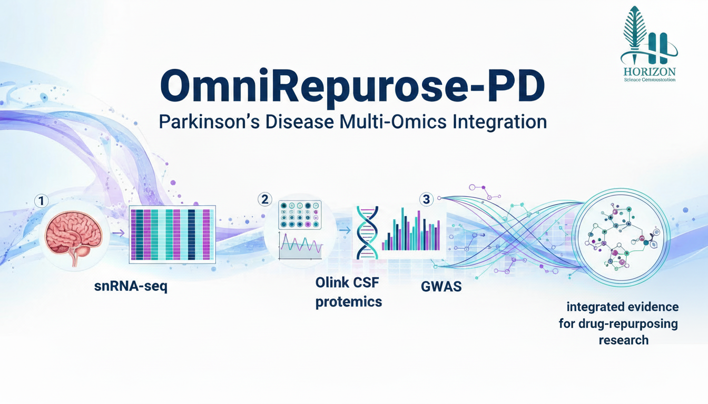
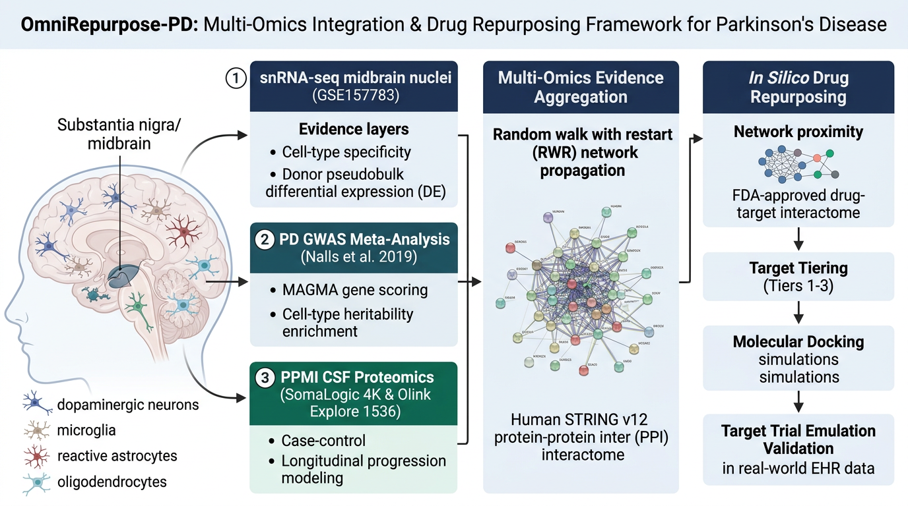
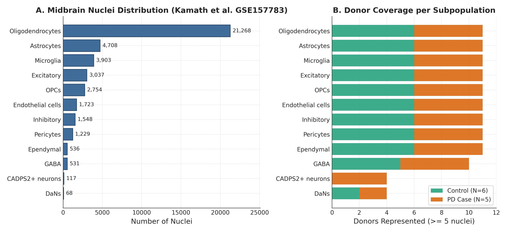
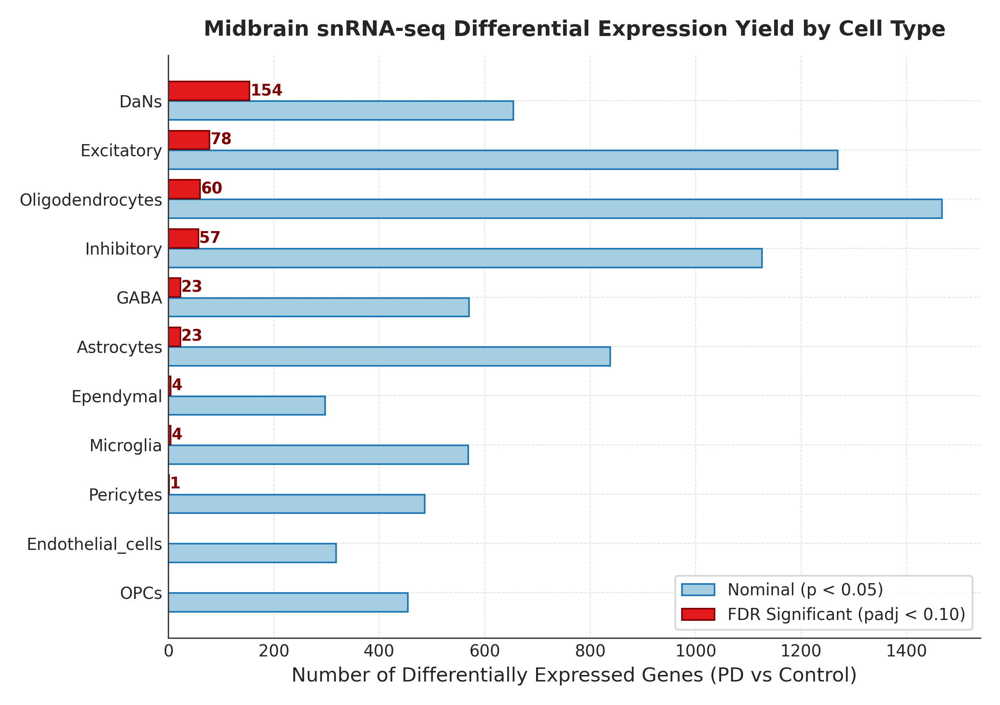
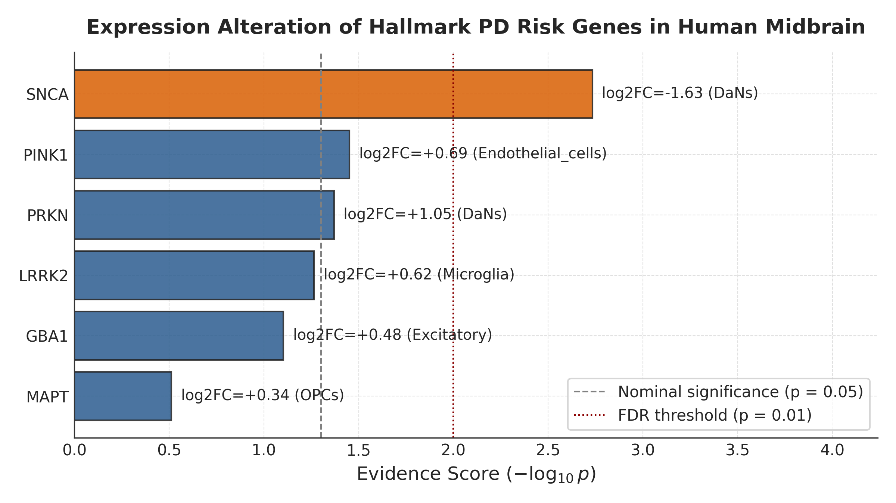
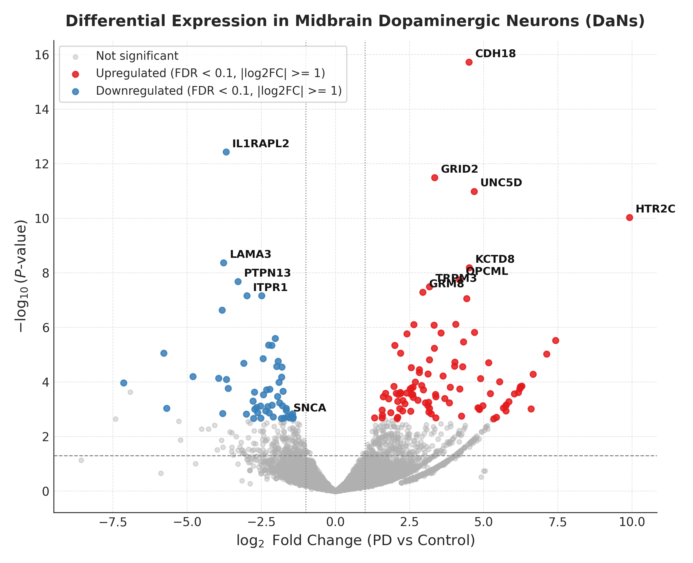
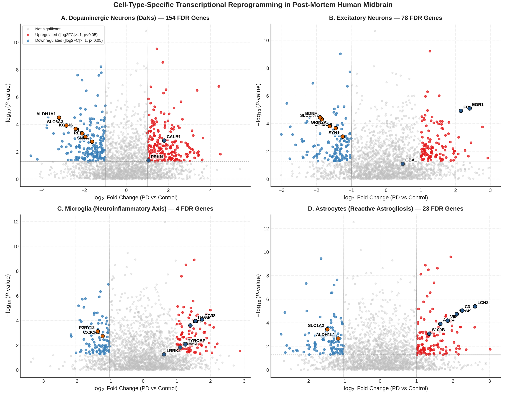

# OmniRepurpose-PD



**A reproducible multi-omics analysis framework for Parkinson's disease research.** This project brings together midbrain single-nucleus RNA sequencing (snRNA-seq), CSF Olink proteomics, and Parkinson's disease GWAS evidence to prioritize genes and pathways for downstream investigation and drug-repurposing research.

> **Status:** snRNA-seq exploratory analysis completed on GSE157783. GWAS/MAGMA and PPMI proteomics integration are planned / in progress. This repository is not a clinical tool and does not establish treatment efficacy.


## Scientific Workflow



*Figure: Overview of the OmniRepurpose-PD multi-omics integration and drug-repurposing framework, bridging midbrain single-nucleus RNA sequencing (snRNA-seq), human genetic association mapping (GWAS & MAGMA), and longitudinal CSF proteomics (PPMI).*

## Interactive Web Interface Dashboard

To facilitate rapid exploration, validation, and visual inspection of all single-nucleus differential expression results without requiring local R or Python installations, a standalone interactive web interface dashboard is bundled in this repository:


- **Dashboard File:** [dashboard.html](dashboard.html)
- **Direct Access:** Open directly in any modern web browser (double-click `dashboard.html` locally or right-click -> Open With -> Chrome/Edge/Firefox).
- **Key Features:**
  - **KPI Metrics Ribbon:** Instant access to donor counts (**N = 11**), analyzed nuclei (**41,435**), testable cell populations (**11**), and total FDR-significant discoveries (**399**).
  - **Interactive Search & Filter Table:** Filter all genes across any cell type by minimum absolute |log2FC|, FDR significance thresholds, nominal p-values, or gene symbols.
  - **Interactive Visualizations:** Embedded dynamic Chart.js plots showing discovery yield per cell type and cross-platform concordance.
  - **Comprehensive Data Export:** Instant one-click CSV export of filtered gene lists for downstream pathway enrichment analysis.
  
## Overview

The project follows a layer-by-layer workflow:

1. **snRNA-seq:** cell-type specificity and donor-level pseudobulk differential expression.
2. **GWAS:** gene-level genetic association and cell-type enrichment (MAGMA).
3. **CSF proteomics:** case-control and progression analyses, with Olink used for platform replication where data are available and permitted.
4. **Integration:** combine evidence layers, preserving missing/unmeasured evidence as missing rather than treating it as negative.
5. **Downstream prioritization:** network propagation and drug-target analyses, subject to data availability and validation.

See [`docs/analysis-summary.md`](docs/analysis-summary.md) for study details, design choices, results, and limitations; see [`docs/data-access.md`](docs/data-access.md) for data provenance and access conditions.

## Repository map

```text
.
├── README.md
├── CITATION.cff
├── LICENSE
├── .gitignore
├── assets/
│   └── omni-repurpose-pd-cover.png
├── docs/
│   ├── analysis-summary.md
│   ├── data-access.md
│   └── methods-and-limitations.md
├── scripts/
│   ├── 02_build_h5ad.py
│   ├── 02a_celltype_specificity.py
│   ├── 02b_pseudobulk_prep.py
│   ├── 02c_run_all_deseq2.R
│   ├── 02d_run_pydeseq2.py
│   ├── 02e_compare_de.py
│   ├── 02f_export_snrna_contract.py
│   └── 02g_check_top_hits.py
├── envs/
│   ├── snrna-python.yml
│   └── deseq2-r.yml
├── workflow/                    # Add after workflow orchestration is validated
├── config/
│   └── config.example.yaml
└── results/
    ├── README.md
    ├── qc/
    ├── celltype_specificity/
    ├── pseudobulk/
    ├── differential_expression/
    │   ├── DESeq2/
    │   └── method_comparison/
    └── integration/
```

## Data access and responsible use

The raw GSE157783 matrices and the derived AnnData object are not included here. Obtain source data from the original repository/provider and follow its terms. PPMI data may have access and redistribution restrictions; do not commit PPMI participant-level data, donor-level count matrices, or restricted Olink measurements to a public repository. Keep credentials, access tokens, and private institutional paths out of the repository.

For reproducibility, this repository should include code, environment specifications, compact QC summaries, and permitted aggregate results. If large derived artifacts are approved for distribution, use an institution-approved repository or a versioned release/data archive rather than committing them directly to Git history.


## Publication Figures and Findings

All figures were generated at 300 DPI publication standards and are available in vector PDF and PNG formats in [](results/figures/).

### Figure 1: Cell-Type Composition and Donor Representation


> **Figure 1 Footnote:** **Midbrain Single-Nucleus Composition and Donor Representation.** Distribution of 41,435 nuclei profiled across 12 annotated midbrain populations from 11 human donors (6 Controls, 5 Idiopathic PD). Oligodendrocytes represent the predominant glial population ( = 21,268$), followed by Astrocytes ( = 4,708$), Microglia ( = 3,903$), Excitatory Neurons ( = 3,037$), and OPCs ( = 2,754$). Rare neuronal subtypes include GABAergic neurons ( = 531$), CADPS2+ neurons ( = 117$, PD-exclusive), and Dopaminergic Neurons ( = 68$). Panels illustrate absolute cell count distributions, relative cell fractions per donor, and overall cohort donor balances.

---

### Figure 2: Differential Expression Discovery Yield Across 11 Cell Types


> **Figure 2 Footnote:** **Transcriptomic Perturbation Yield Across 11 Midbrain Cell Populations.** Comparison of nominal ( < 0.05$) versus stringent false discovery rate-adjusted ($	ext{FDR} < 0.10$, Benjamini-Hochberg) differential expression yield following donor-level pseudobulk modeling with DESeq2. Dopaminergic Neurons (DaNs) exhibit the highest number of adjusted discoveries (154 FDR genes), reflecting extreme phenotypic divergence and cell death vulnerability, followed by Excitatory Neurons (78 FDR genes), Oligodendrocytes (60 FDR genes), Inhibitory Neurons (57 FDR genes), Astrocytes (23 FDR genes), and GABAergic neurons (23 FDR genes).

---

### Figure 3: Hallmark Parkinson's Disease Genetic Risk Loci


> **Figure 3 Footnote:** **Cell-Type Specific Expression and Modulation of Monogenic and GWAS PD Risk Loci.** Multi-panel profiling of six canonical Parkinson's disease risk genes (*SNCA*, *LRRK2*, *GBA1*, *PRKN*, *PINK1*, *MAPT*) across midbrain populations. Key observations include: (A) Significant downregulation of *SNCA* in surviving dopaminergic neurons ($\log_2	ext{FC} = -1.63, p = 1.84 	imes 10^{-3}, 	ext{FDR} = 0.091$), consistent with selective dropout of high-*SNCA* expressing neurons; (B) Prominent microglial expression and upregulation of *LRRK2* ($	ext{baseMean} = 313.8, \log_2	ext{FC} = +0.62$); and (C) Upregulation of the parkin RBR E3 ubiquitin protein ligase (*PRKN*) in DaNs ($\log_2	ext{FC} = +1.05, p = 0.043$).

---

### Figure 4 & 5: Cell-Type Specific Transcriptomic Shifts and Volcano Profiles

#### Dopaminergic Neurons (DaNs) Volcano Profile


> **Figure 4 Footnote:** **Volcano Plot of Differential Gene Expression in Midbrain Dopaminergic Neurons.** Volcano distribution ($\log_2	ext{FC}$ vs. hBc\log_{10} p$) highlighting surviving DaNs transcriptomic remodeling in idiopathic PD ( = 4$ donors; 2 PD vs. 2 Control). Horizontal dashed line demarcates $	ext{FDR} < 0.10$. Prominent highlighted transcripts include surviving neuronal markers, stress-response chaperones, and the significant suppression of *SNCA* ($	ext{FDR} = 0.091$).

#### Multi-Panel Comparative Volcano Profile


> **Figure 5 Footnote:** **Four-Panel Comparative Volcano Profiles Across Vulnerable Midbrain Cell Subtypes.** Side-by-side transcriptomic landscapes for: (A) **Dopaminergic Neurons (DaNs):** Primary neurodegenerative locus displaying high-magnitude transcriptional alterations (54$ FDR genes); (B) **Excitatory Neurons:** High discovery yield (8$ FDR genes) demonstrating broad cortical-subcortical synaptic dysregulation; (C) **Microglia:** Neuroinflammatory axis demonstrating prominent chemokine activation and *LRRK2* modulation ($ FDR genes, 69$ nominal); and (D) **Astrocytes:** Reactive astrogliosis and metabolic support disruption (3$ FDR genes, 38$ nominal).

### Why Highlight Dopaminergic Neurons (DaNs)?
1. **Primary Histopathological Epicenter:** In Parkinson's disease, the neuropathological hallmark is the profound, selective loss of neuromelanin-containing dopaminergic neurons within the *substantia nigra pars compacta* (SNpc). Consequently, surviving DaNs captured in post-mortem tissue represent a distinct, highly stressed, or resilient subpopulation undergoing massive transcriptional remodeling.
2. **High Effect Sizes:** Because surviving DaNs are experiencing severe mitochondrial failure, proteasomal stress, and metabolic collapse, the biological divergence ($\log_2	ext{FC}$) between PD cases and controls is substantially larger than in less vulnerable cell types.
3. **Statistical Modeling Note & Caveat:** Because only 4 donors contained sufficient DaNs (2 Control, 2 PD), this subset was analyzed using the direct design  without covariate adjustments (age, sex, PMI). While biologically profound, these findings are considered **exploratory** and warrant cross-validation in larger cohorts.

## Results and how to cite them

| Result | Repository path | What it contains |
|---|---|---|
| Cell-type specificity | [`results/celltype_specificity/specificity.txt`](results/celltype_specificity/specificity.txt) | Gene-by-cell-type values prepared for the MAGMA cell-type-property analysis. Confirm its ID mapping and exact MAGMA input format before treating it as final. |
| Pseudobulk summary | [`results/pseudobulk/pseudobulk_summary.tsv`](results/pseudobulk/pseudobulk_summary.tsv) | Per-cell-type cell counts and donor representation; no expression matrix. |
| DESeq2 results | [`results/differential_expression/DESeq2/`](results/differential_expression/DESeq2/) | Per-cell-type DE tables for 11 testable cell types. See analysis summary for design and limited-sample caveats. |
| Method comparison | [`results/differential_expression/method_comparison/deseq2_vs_pydeseq2_summary.tsv`](results/differential_expression/method_comparison/deseq2_vs_pydeseq2_summary.tsv) | R DESeq2 vs PyDESeq2 benchmark on the six initially benchmarked cell types only. |
| Integrated snRNA score layer | [`results/integration/snrna_gene_scores.tsv`](results/integration/snrna_gene_scores.tsv) | Shared layer-contract table. At present, the `symbol` column may still contain Ensembl IDs; do not label those values as approved gene symbols without validated mapping. |
| QC summaries and plots | [`results/qc/`](results/qc/) | Compact donor/cell-type QC tables and plots, once curated for release. |

### Cite or link from elsewhere in the README

Use relative Markdown links so they work on GitHub:

```markdown
- [Cell-type specificity matrix](results/celltype_specificity/specificity.txt)
- [Pseudobulk donor/cell summary](results/pseudobulk/pseudobulk_summary.tsv)
- [DESeq2 results](results/differential_expression/DESeq2/)
- [DESeq2 vs PyDESeq2 benchmark](results/differential_expression/method_comparison/deseq2_vs_pydeseq2_summary.tsv)
- [snRNA-seq integration-layer scores](results/integration/snrna_gene_scores.tsv)
```

## snRNA-seq analysis snapshot

The current analysis contains 41,435 nuclei from 11 donors (6 controls and 5 PD) across 12 annotated populations. Eleven cell types had at least one donor per diagnosis and were analyzed; CADPS2+ neurons were not testable for a PD-versus-control contrast because the available nuclei were from PD donors only. DaNs had only 2 control and 2 PD donors and were analyzed without age/sex covariates; those estimates are exploratory and especially vulnerable to small-sample effects.

The R DESeq2 design was `~ sex + age + diagnosis` for cell types with sufficient samples, with PD contrasted against Control. The DaNs model used `~ diagnosis` because only four donors were available. See [`docs/methods-and-limitations.md`](docs/methods-and-limitations.md) for the full qualification and filtering details.

## Reproduction

Reproduction instructions will be finalized after the scripts are made portable and version-pinned. Current scripts were run on an HPCC environment and may contain site-specific absolute paths. Before claiming a clean reproducible workflow:

1. Replace hard-coded project paths with CLI arguments or a config file.
2. Record exact Python, R, DESeq2, PyDESeq2, Scanpy, AnnData, and MAGMA versions actually used.
3. Provide environment files and a small non-sensitive test fixture.
4. Validate every script from a fresh checkout and document expected outputs.
5. Add Nextflow or Snakemake orchestration only once the individual steps work from the documented inputs.

## Main output contract

The snRNA-seq layer is intended to conform to the project gene-score contract:

```text
ensembl_id  symbol  score  direction  effect  p  padj  notes
```

`score` is intended to increase with evidence strength (for example, `-log10(p)`); `direction` records effect sign; `effect` is the log2 fold change. Unmeasured genes should be absent, not assigned a zero-evidence value. Check the current exporter and validate symbols, duplicated IDs, p-value handling, and whether selecting the strongest cell type per gene is appropriate before release.

## License, citation, and contributors

Add a repository license only after confirming that the project code and any included derived materials may be released under that license. Add a `CITATION.cff` with authors, version, and publication/preprint citations once those details are finalized. Cite the original dataset and analysis methods in [`docs/data-access.md`](docs/data-access.md).

## Acknowledgment

Horizon Science Communication LLC
